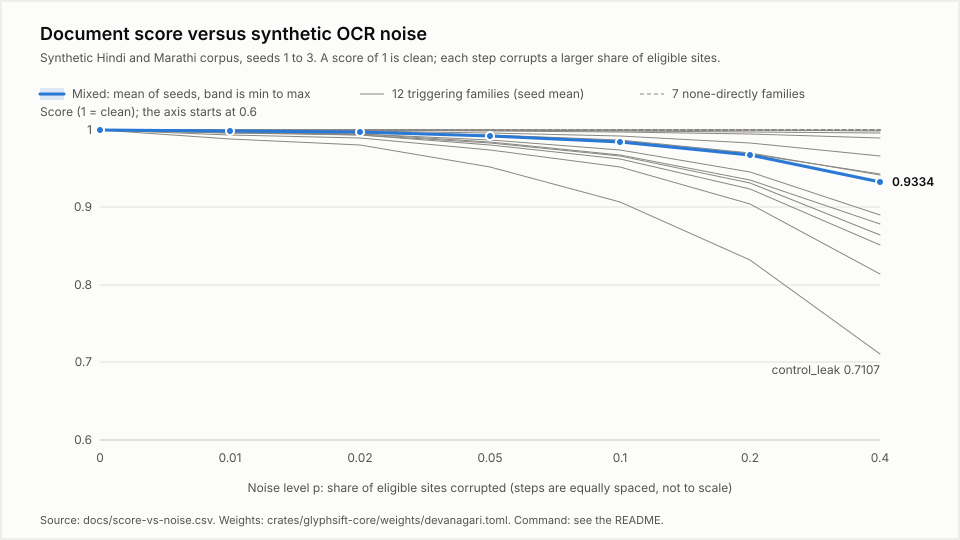

# glyphsift

Scores whether extracted Indic text is clean enough to trust or train on: a deterministic
Devanagari grapheme-cluster validator with a Rust core, a WASM build for the browser, a Python
wheel and a CLI. Sixteen structural rules, a document score from 0 to 1, per-line scores, a per-chunk
pass/hold gate, no model and no network.

Part of [Airplane Mode Labs](https://github.com/AirplaneMode-Labs), an open-core, offline-first,
browser-native AI infrastructure lab. Package names use the placeholder scope `@airplanemode` /
crate and package names `glyphsift` until the handles are reserved; nothing is published yet.

## Status

Sprint 6 (19 Nov 2026): Working: everything from Sprint 5, plus a short page on what glyphsift measures, linked from the demo and built only from the committed benchmark: the score falls as synthetic noise rises (0 of 60 series rise), the gate threshold is 975000 ppm, and native, Python and WebAssembly give the same bytes on 13 samples and 200 gate cases; the shipped source package now runs its corrupt-feature tests; 0 requests after the page loads. Not yet: scripts other than Devanagari (Tamil is planned for v0.2 as a design note only, Bengali later), a published package or wheel, 8 GB figures (not measured on 8 GB).

In more detail, for the Sprint 6 release candidate: glyphsift **0.1.2 is a release candidate, not tagged** (0.1.0 and 0.1.1 were never tagged; 0.1.2
supersedes them, TD-69). New in Sprint 6, none of it a change to the scoring (the benchmark CSV and the reports are byte-identical): a short page,
[docs/what-glyphsift-measures.md](docs/what-glyphsift-measures.md), that says what the score is and quotes only numbers read from committed files (a test,
`tests/docs_numbers.py`, re-reads each one), linked from the demo footer as text; the shipped source package now runs its two corrupt-feature test files
(`cargo test --locked --no-fail-fast -p glyphsift-core --features corrupt` from the unpacked sdist: S1-118, BUG-T2-S5-15 and -16, with
`docs/corruption-generator.md` added to the files it carries); and the native determinism leg and `scripts/build-wasm.sh` read their build output from
`${CARGO_TARGET_DIR:-target}` (BUG-T2-S5-14, `tests/scripts/cargo-target-dir.sh`). The measures page says what is not claimed: Devanagari only, unpublished,
synthetic text only, no claim about Hindi answer quality, and no 8 GB figure (not measured on 8 GB). Sprint 5 brought: the **gate call** (TD-42), `gate(text, threshold_ppm)`: for one chunk of extracted text it answers `pass`,
`hold` (a Devanagari chunk scoring below the threshold, 975000 ppm by default) or `not_scored` (text that is not mostly
Devanagari is passed through unjudged), as the same canonical JSON `glyphsift.gate/0.1` from the Rust core, the CLI
(`glyphsift gate`), the Python wheel and the WASM build, byte-identical on a 200-case corpus, with the rules and the derivation
of the default threshold in [docs/gate.md](docs/gate.md) and a Gate tab in the demo. Also new: the sdist now builds
`cargo build --locked` from its own `Cargo.lock` (S1-103, `scripts/package-sdist.sh`), and the first CI run of the `wheels`
job has been read: run 43667702791 at 5ff0c47 built a `manylinux_2_17` wheel, a `win_amd64` wheel, a macOS arm64 wheel and an
sdist, and all 14 jobs were green on 15 Nov 2026 (read with `gh` on 18 Nov 2026; [docs/release.md](docs/release.md) records
what that proved and what it did not). Linux and Windows wheels and an sdist were built by CI; nothing is published, tagged
or signed. The scoring did not change in Sprint 5: the benchmark CSV and the reports are byte-identical. Everything is
tested on this repository's synthetic text only. Not yet: scripts other than Devanagari (Tamil planned for v0.2, design note
[docs/v0.2-tamil.md](docs/v0.2-tamil.md), nothing implemented), a published package or wheel, any claim about the quality of
Hindi answers built on gated text. What is open before a tag is in [docs/release.md](docs/release.md): CI read on three
operating systems for the Sprint 5 commit after the owner's push, the 8 GB laptop benchmark (not measured on 8 GB), signed
artifacts, the tag, publishing and the write-up.

## Install

Not published yet: the npm scope @airplanemode and the PyPI and crates.io names are not reserved. The commands below were proven from locally built artifacts on macOS arm64 (an npm pack tarball installed offline into a fresh empty directory, a wheel installed into a fresh venv); publishing to the registries is the owner's step.

From a clone of this repository (Rust 1.98 comes from `rust-toolchain.toml`):

```sh
# Command line: installs the `glyphsift` binary (0.1.2) under <dir>/bin. The RUSTFLAGS prefix keeps your home
# and checkout paths out of the binary (optional; scripts/remap-paths.sh sets the same flags for the build scripts)
RUSTFLAGS="--remap-path-prefix=$HOME/.cargo=/cargo --remap-path-prefix=$HOME/.rustup=/rustup --remap-path-prefix=$PWD=/glyphsift" cargo install --path crates/glyphsift-cli --locked --root <dir>

# Python wheel (abi3, CPython >= 3.9): built, then installed into a fresh venv, offline
# (scripts/package-python.sh does this with the tool versions pinned and the builder paths remapped; CI gives it
# uv, maturin and mypy from tools/ci/requirements.txt, pinned by hash: python -m pip install --require-hashes
# --no-deps --only-binary=:all: -r tools/ci/requirements.txt, then GLYPHSIFT_TOOLS_VENV=<that venv>)
. scripts/remap-paths.sh && uvx maturin@1.16.0 build --release --locked -m crates/glyphsift-py/Cargo.toml -o target/wheels
python3 -m venv venv && venv/bin/pip install --no-index --no-deps target/wheels/glyphsift-0.1.2-cp39-abi3-macosx_11_0_arm64.whl
uv venv uvenv && uv pip install --offline --no-index --no-deps --python uvenv/bin/python target/wheels/glyphsift-0.1.2-cp39-abi3-macosx_11_0_arm64.whl

# npm package @airplanemode/glyphsift (WASM, Node and browser): packed, then installed offline into an empty directory
scripts/install-wasm-tools.sh    # wasm-bindgen 0.2.129 and binaryen from digest-pinned release binaries (default ~/.local/glyphsift-tools)
scripts/build-wasm.sh && scripts/package-npm.sh      # dist/npm/airplanemode-glyphsift-0.1.2.tgz
mkdir app && cd app && npm init -y && npm i ../dist/npm/airplanemode-glyphsift-0.1.2.tgz --ignore-scripts --offline --no-audit --no-fund

# The source distribution: builds with maturin, prunes its Cargo.lock to its own workspace, and proves cargo build --locked from it
scripts/package-sdist.sh      # dist/sdist/glyphsift-0.1.2.tar.gz

# The demo: demo/dist/ (runs build-wasm.sh first)
scripts/build-demo.sh
```

What was proven, and where: the wheel is `glyphsift-0.1.2-cp39-abi3-macosx_11_0_arm64.whl`, platform tag
`macosx_11_0_arm64`, and it installed with `python3 -m venv` plus `pip install --no-index --no-deps` and with
`uv venv` plus `uv pip install --offline --no-index --no-deps`, each followed by a `python -I` call that printed
750000 for `score_ppm('कखग\ufffd')` and checked `gate()` (`evidence/sprint-6/D3/green/package-python.log`, rebuilt for 0.1.2). **Linux and Windows wheels and an sdist were built by CI**
(run 43667702791 at 5ff0c47, the `wheels` job, read on 18 Nov 2026: a `manylinux_2_17` wheel through zig, a `win_amd64` wheel and an
sdist, each wheel installed into a fresh venv with `--no-index` and answering `ppm 1000000`; they are workflow artifacts kept for
7 days, not releases, and `docs/release.md` lists what that run proved and what it did not). The sdist built by `scripts/package-sdist.sh` builds
`cargo build --locked` from its own pruned `Cargo.lock` (61 lock entries pruned to the 36 its workspace needs, same versions and
checksums: `evidence/sprint-6/D3/green/package-sdist.log`; `tests/scripts/sdist-locked.sh` also runs `cargo test --locked --features corrupt` from the unpacked tree and counts the corrupt tests that ran). The npm tarball installed offline from an empty
cache with install scripts off; `npm ls` showed exactly that one package, and a Node call and a bundler-free
page in installed Chrome gave the report `glyphsift check` and the verdict `glyphsift gate` print (`evidence/sprint-6/D3/green/package-npm.log`). The CLI
installed with `cargo install --path` and ran with every documented exit code
(0.1.1, `evidence/sprint-5/D3/green/cli-install.log`; not repeated for 0.1.2). The wheel, the tarball and each crate carry `LICENSE` and `NOTICE`. The wheel and the tarball contain no test data,
no source map, no install script and no file over 5 MB. The source packages `cargo package --list` would upload
do include each crate's `tests/` (`glyphsift-core` ships `tests/cases/devanagari.toml`, invented strings, and `tests/*.rs`;
`glyphsift-cli` ships `tests/*.rs`) so the crates can be tested from the registry; that is intended. Third-party crates
and the compiled Unicode tables that ship inside the wheel, the WASM and the CLI are listed with their licences in
[NOTICE](NOTICE). Builder paths (home, cargo, rustup and checkout directories) are remapped out of the Rust builds with
`--remap-path-prefix` (`scripts/remap-paths.sh`) and `scripts/package-python.sh`, `scripts/package-npm.sh` and the sdist test
fail if any packed file contains a home-directory, checkout or scratch-directory prefix (`scripts/check-no-builder-paths.py`).

### After the owner publishes

Once the handles are reserved and the artifacts are published, these will work; they have not been run:

```sh
pip install glyphsift
npm i @airplanemode/glyphsift
cargo install glyphsift-cli
```

## Quick start

### CLI

```sh
echo 'नमस्ते।' | glyphsift check -
# {"spec":"glyphsift.report/0.2","script":"devanagari","code_points":7,"clusters":[...],"issues":[],
#  "summary":{...},"lines":[{"index":0,...,"score_ppm":1000000}],"score":{"ppm":1000000,"penalty":0,...}}

printf 'कखग\xef\xbf\xbd' | glyphsift check - --fail-under 800000 > /dev/null; echo $?
# score 750000 is below 800000: the report is printed, the exit code is 4

printf 'कखग\xef\xbf\xbd' | glyphsift gate -
# {"spec":"glyphsift.gate/0.1","scored":true,"script":"devanagari","devanagari_ppm":1000000,"ppm":750000,
#  "threshold_ppm":975000,"verdict":"hold"}   (exit 0: a hold is an answer, not an error)
printf 'hello' | glyphsift gate - --threshold-ppm 900000
# {"spec":"glyphsift.gate/0.1","scored":false,"script":"other","devanagari_ppm":0,"ppm":null,
#  "threshold_ppm":900000,"verdict":"not_scored"}
```

(From a clone, `cargo run -q -p glyphsift-cli -- check -` runs the same thing without installing.)

- `glyphsift check FILE|- [--fail-under PPM]` validates UTF-8 text from a file or standard input (up to 4 MiB)
  and prints the canonical JSON report. `--fail-under` is a threshold in parts per million, 0 to 1000000.
- `glyphsift gate [--threshold-ppm N] FILE|-` judges one chunk of text and prints the canonical `glyphsift.gate/0.1` JSON:
  `pass`, `hold` (a Devanagari chunk scoring below `N`, default 975000) or `not_scored` (not mostly Devanagari). Every
  verdict exits 0; input that is not valid UTF-8 is a usage error (exit 2).
- `glyphsift corrupt --family <name>|mixed --p <decimal> --seed <u64> [--sites <path>]` applies a seeded
  OCR-noise family to clean text on standard input (`--list-families` prints the 19 names and `mixed`).
- `glyphsift bench --corpus <path> --seeds 1,2,3 --csv <path> --svg <path>` runs the score-versus-noise
  benchmark and writes the CSV and the chart; `glyphsift bench --verify <csv>` re-checks an existing CSV.
- `glyphsift --help`, `glyphsift <command> --help` and `glyphsift --version` (0.1.2) exit 0.

Exit codes, the same for every command:

| Code | Meaning |
|---|---|
| 0 | Success: `check` printed the report and the score is not under `--fail-under`; `corrupt` wrote its output; `bench` met the criterion (or `--verify` passed) |
| 1 | I/O error, invalid UTF-8, input over 4 MiB, or a failed `bench` criterion (`bench --verify` on a CSV that violates it) |
| 2 | Usage error: missing or bad arguments, an unknown command or family; for `gate` also input that is not valid UTF-8 and a threshold outside 0 to 1000000 |
| 4 | `check --fail-under`: the score is below the threshold (the report is still printed) |

There is no exit code 3. Installing the CLI from the crates.io registry works only after the owner publishes
(see "After the owner publishes" above); until then the proven command is
`cargo install --path crates/glyphsift-cli --locked --root <dir>` (prefix it with the `RUSTFLAGS=...` shown under Install to
keep builder paths out of the binary).

The corruption generator and the benchmark:

```sh
glyphsift corrupt --family matra_detach --p 0.05 --seed 7 < bench/corpus/clean.txt > out.txt
glyphsift corrupt --list-families
glyphsift bench --corpus bench/corpus/clean.txt --seeds 1,2,3 --csv docs/score-vs-noise.csv --svg docs/score-vs-noise.svg
```

### Python

```python
import json, glyphsift

report = json.loads(glyphsift.validate("नमस्ते।"))   # the same bytes as `glyphsift check`
print(report["score"]["ppm"])                         # 1000000 is clean
print(glyphsift.score_ppm("कखग\ufffd"))               # 750000
print(glyphsift.clusters("नमस्ते।"))                  # ['न', 'म', 'स्ते', '।']
print(json.loads(glyphsift.gate("कखग\ufffd"))["verdict"])   # hold  (the gate, below)
```

`validate`, `score_ppm`, `clusters` and `gate` raise `ValueError` over 4 MiB. The wheel ships type stubs (`glyphsift.pyi`,
`py.typed`); `mypy --strict` passes on a script that uses them.

### Node and the browser

```js
const { validate, score_ppm } = require("@airplanemode/glyphsift");   // Node: no init() needed
console.log(JSON.parse(validate("नमस्ते।")).score.ppm);               // 1000000
```

```html
<script type="module">   <!-- browser, no bundler -->
  import init, { validate } from "./node_modules/@airplanemode/glyphsift/web/glyphsift.js";
  await init();
  console.log(JSON.parse(validate("नमस्ते।")).score.ppm);
</script>
```

Exports: `validate(text)`, `score_ppm(text)`, `report_spec()`, `clusters(text)`, `clusters_json(text)`,
`issue_kinds()`, `gate(text, threshold_ppm?)`, `gate_spec()` and `default_gate_threshold_ppm()`; nothing else. For valid
Unicode text, all three runtimes return byte-identical reports.

### The gate

A pipeline that ingests extracted text chunk by chunk needs one decision per chunk. `gate(text, threshold_ppm)` gives it, in
the core, the CLI (`glyphsift gate`), Python (`glyphsift.gate(text, threshold_ppm=None)`) and WASM or Node
(`gate(text, threshold_ppm?)`), as the canonical JSON `glyphsift.gate/0.1`: `{scored, script, devanagari_ppm, ppm,
threshold_ppm, verdict}`. Letters are alphabetic code points plus the three Devanagari blocks; a chunk with no letters
(script `none`) or under 500,000 ppm Devanagari (script `other`) is `not_scored`, passed through unjudged, with `ppm` null;
otherwise `ppm` is exactly the document score and the verdict is `pass` at or above the threshold, `hold` below it. The default
threshold, 975000, is derived from `docs/score-vs-noise.csv` in [docs/gate.md](docs/gate.md), which also says what a hold
means for a reader and which noise level produces one (the gate holds `control_leak` at p=0.1 on 285 of 288 three-line chunks).
A string with an unpaired surrogate is rejected by every binding (WASM: a `TypeError`, before the module is called, because
wasm-bindgen would turn it into U+FFFD; Python: `ValueError`; the CLI: exit 2), and a threshold outside 0 to 1000000 is refused. Native, Python
and WASM print identical bytes on the 200-case corpus in `tests/determinism/gate/` (`scripts/determinism.sh`), and 10,000
seeded random strings plus the 4 MiB boundary cause no panic (`cargo test`).

## How it works

1. Text is split into UAX #29 extended grapheme clusters (unicode-segmentation 1.13, including the
   Unicode 15.1 GB9c conjunct rule, so `क्ष` is one cluster).
2. Each cluster is parsed once, left to right, against the Devanagari cluster grammar
   `(C nukta? virama (ZWJ|ZWNJ)?)* C nukta? matra? (anusvara|chandrabindu)? visarga?` and its
   alternatives for independent vowels and standalone signs, and checked by sixteen rules, each
   a small predicate with a stable name (`dependent_vowel_without_base`, `double_matra`,
   `virama_after_matra`, `zwj_zwnj_misplaced`, `mixed_script_in_cluster`, `control_character`, ...).
   Two rules look at the cluster's first code point: a joiner (ZWJ, ZWNJ) is flagged only in a
   Devanagari-based cluster or when it starts a cluster, so emoji sequences and Persian words are left
   alone, and invisible tag characters and non-Indic combining marks on a Devanagari letter are flagged.
   The code-point tables, the grammar and every rule are in
   [docs/devanagari-rules.md](docs/devanagari-rules.md); the executable form is the case table
   `crates/glyphsift-core/tests/cases/devanagari.toml` (154 cases, written before the code).
3. Each flagged cluster costs the **largest** weight among its issues. Weights are integers from 1
   to 1000, one per rule, in [crates/glyphsift-core/weights/devanagari.toml](crates/glyphsift-core/weights/devanagari.toml),
   every line with a `# source:` comment. The document score is an integer in parts per million:

   ```text
   ppm = 1_000_000 - floor(penalty * 1000 / cluster_count)      (saturating; 1_000_000 for empty input)
   ```

   so one broken cluster out of four at weight 1000 scores 750_000. The same formula gives a score per
   line (`lines[i].score_ppm`; LF, CRLF or a bare CR ends a line). Shown with four decimals by integer
   formatting, truncated: 704762 is 0.7047.
4. The report (`glyphsift.report/0.2`) is serialised as compact JSON with fields in declaration order
   and no floating point, so for valid Unicode text native, Python and WASM builds emit byte-identical output.

Determinism is enforced: `clippy.toml` forbids hash-based collections and the platform `libm`, a test
scans `glyphsift-core/src` for floating-point types and hash collections, and the core reads no
clock, environment or file.

## Contracts

glyphsift consumes no runtime/spec contract yet and emits no events: the text being scored never leaves the
process. Emitting `airplanemode.event/0.1` timings is not implemented. Its own wire format is the report,
`glyphsift.report/0.2` (docs/devanagari-rules.md section 5), which Sprint 3 left unchanged: no rule was added or
removed and no weight changed, so reports from 0.2 consumers keep their shape.

## Demo

Live demo: <https://airplanemode-labs.github.io/glyphsift/>. Built from `main` by
`.github/workflows/pages.yml` on every push, with a box titled "What this demo does not do yet". It
runs entirely in the browser: no upload, no analytics, no third-party scripts or fonts. (The live page shows Sprint 5
(read on 19 Nov 2026). The Sprint 6 changes, the measures page linked in the footer and the new status line, are committed locally and not
pushed: the live page changes only after the owner pushes and the workflow runs. The Sprint 6 demo was proven on a local build served under
`/glyphsift/`: `evidence/sprint-6/D3/green/D3-04-demo.log`, 243 checks, 0 console errors.) The footer links the third-party
notices as `NOTICE.txt`, which Pages serves as `text/plain` so that it opens in the browser instead of downloading
(BUG-T1-S3-R2-01); it carries the MIT texts of the WebAssembly crates that are not offered under Apache-2.0, among
them zmij (its licence file has no copyright line, so the notice names the author from its `Cargo.toml`)
(`evidence/sprint-4/D3/green-D3-03.log`).

It shows the real report for pasted text, a local `.txt` file or one of five synthetic samples (clean,
OCR-corrupted, legacy font read as Latin, legacy font residue, adversarial):

- the document score with four decimals;
- **a heatmap**: one row per line with a strip shaded by the sum of the weights of that line's issues, then every
  grapheme cluster of the line shaded by the sum of the weights of the rules that fired on it (buckets: clean 0,
  low 1 to 399, mid 400 to 799, high 800 and above; underline style and weight repeat the bucket so colour is not
  the only cue; hover a cluster for its rules; capped at 20,000 clusters with a note);
- the sixteen rules with their weights and how often each fired, a per-line table, the clusters, and the canonical
  JSON, which is byte for byte what `glyphsift check -` prints for the same text.

**The Gate tab** (Sprint 5): the page has two tabs under the text input, Report (everything above) and Gate. The Gate tab
runs `gate()` in WebAssembly on the same text (pasted, dropped, chosen or a sample) and shows the verdict (pass, hold or not
scored), the Devanagari share, the score, a threshold field (975000 by default; whole numbers from 0 to 1,000,000, anything
else is refused in plain text and the gate is not run) and the canonical JSON, which is byte for byte what `glyphsift gate -`
prints. Text with an unpaired surrogate is refused with a plain-text message before the module is called. Everything is rendered
as text nodes and nothing makes a request.

**Local files**: drop a `.txt` file on the drop zone or choose one with the file picker. The file is read in the
tab with `File.arrayBuffer()` after its size is checked (over 1 MiB is refused unread, with "This file is over 1 MiB"),
decoded with a fatal UTF-8 decoder (invalid bytes are refused with "This file is not valid UTF-8 text"), and the
decoded text is validated exactly, so the report equals `glyphsift check FILE`, BOM and CRLF included. Nothing is
uploaded and no request is made. Pasted input over 1 MiB is refused before the WASM module is called. Every
report-derived, file-derived and pasted string is rendered with `textContent`, every attribute is set with
`setAttribute` from a fixed set of values, and no element carries a style attribute. Sources in `demo/`;
`scripts/build-demo.sh` assembles `demo/dist/` (git-ignored). Verification: see Develop; the run that checked
all of this is `evidence/sprint-3/D3/green-D3-07.log`, with screenshots `evidence/sprint-3/D3/shots/`.

## Benchmarks



Reproduce (about one second in release mode; the CSV and SVG come out byte-identical every time):

```sh
cargo run -p glyphsift-cli --release -- bench --corpus bench/corpus/clean.txt --seeds 1,2,3 --csv docs/score-vs-noise.csv --svg docs/score-vs-noise.svg
```

The benchmark corrupts the 288-line synthetic Hindi and Marathi corpus `bench/corpus/clean.txt`
(6,117 clusters, every line validating with zero issues) at p in {0, 0.01, 0.02, 0.05, 0.1, 0.2, 0.4}
with each of the 19 noise families of [docs/corruption-generator.md](docs/corruption-generator.md)
and with `mixed` (every family on a disjoint partition of the sites), seeds 1 to 3, and scores each
result. The command exits 1 on any violation of this criterion:

- (a) the mixed-family mean score (over seeds) falls STRICTLY at every consecutive step from p=0 to p=0.4;
- (b) mixed is non-increasing in p for each seed;
- (c) every triggering family is non-increasing in p for each seed;
- (d) score_ppm is 1_000_000 at p=0 for every row.

"Triggering" means the family's "rules it should trigger" column in the corruption doc names rules
(twelve families); the other seven are "none directly" and are reported, not gated. All four parts
hold on the committed `docs/score-vs-noise.csv` (420 rows), and `glyphsift bench --verify
docs/score-vs-noise.csv` re-checks them without regenerating.

**Regenerated in Sprint 3.** Restricting the joiner rule to Devanagari bases (BUG-T2-S2-07) changed 35 rows of the
CSV: the 18 `joiner_inject` rows and the 17 `mixed` rows with p above 0. A joiner injected after a space or other
non-Devanagari cluster is no longer flagged, so those sites cost nothing, and the benchmark's `joiner_inject` sites
declare no expected rule there (recall is still 1.000000). No other row changed, and the weights file and the
corpus did not (their SHA-256 are in the log). The committed CSV was `d20efc20...`; the regenerated one is
`cac89041...` and the SVG changed with it. Two fresh runs are byte-identical, the criterion holds, and the tables
below were regenerated from the new CSV. Evidence: `evidence/sprint-3/D3/bench-s3.log` (hashes before the run, two runs
with SHA-256 of the CSV and SVG, the comparison with the committed files, `--verify`). The Sprint 2 run, on the old
rules, is `evidence/sprint-2/D3/bench-determinism.log`. Numbers below are from `docs/score-vs-noise.csv` and are
scores, 1.0000 being clean; figures are rounded half-up to four decimals (score_ppm divided by 1,000,000).

| Mixed family | p=0 | p=0.01 | p=0.02 | p=0.05 | p=0.1 | p=0.2 | p=0.4 | 8 GB Windows no-GPU laptop |
|---|---|---|---|---|---|---|---|---|
| mean of seeds 1 to 3 | 1.0000 | 0.9985 | 0.9970 | 0.9917 | 0.9840 | 0.9675 | 0.9334 | not measured on 8 GB |
| minimum | 1.0000 | 0.9983 | 0.9969 | 0.9911 | 0.9828 | 0.9651 | 0.9321 | not measured on 8 GB |
| maximum | 1.0000 | 0.9988 | 0.9971 | 0.9927 | 0.9852 | 0.9705 | 0.9359 | not measured on 8 GB |

The twelve triggering families, mean of seeds 1 to 3:

| Family | p=0.05 | p=0.4 | 8 GB Windows no-GPU laptop |
|---|---|---|---|
| `matra_double` | 0.9865 | 0.8906 | not measured on 8 GB |
| `matra_detach` | 0.9846 | 0.8788 | not measured on 8 GB |
| `nukta_spurious` | 0.9959 | 0.9669 | not measured on 8 GB |
| `virama_insert` | 0.9748 | 0.8143 | not measured on 8 GB |
| `bindu_swap` | 0.9999 | 0.9991 | not measured on 8 GB |
| `sign_order` | 0.9995 | 0.9956 | not measured on 8 GB |
| `joiner_inject` | 0.9935 | 0.9420 | not measured on 8 GB |
| `legacy_font` | 0.9989 | 0.9894 | not measured on 8 GB |
| `word_boundary` | 0.9838 | 0.8643 | not measured on 8 GB |
| `random_substitution` | 0.9927 | 0.9427 | not measured on 8 GB |
| `mixed_script` | 0.9806 | 0.8510 | not measured on 8 GB |
| `control_leak` | 0.9516 | 0.7108 | not measured on 8 GB |

Scores are deterministic (byte-identical across native, Python and WASM in scripts/determinism.sh) for valid Unicode text. Not measured on 8 GB: no run on the 8 GB Windows laptop has been made, and every figure here comes from the Apple M5 Pro, 48 GB development Mac.

Recall at p=0.05, the share of corrupted sites that declare an expected rule for which that rule fired in
the damaged cluster, is 1.000000 for every family that declares a rule, in every seed that has one
(`bindu_swap` declares a rule only on its 20% keep-both branch, so seed 3 has none at p=0.05; the
`recall_ppm` column of the CSV is empty where no site declares a rule).

| Throughput on about 1 MiB of the synthetic corpus (1,048,569 bytes, 12,888 lines, 273,779 clusters) | Apple M5 Pro, 48 GB (macOS 27.2.1) | 8 GB Windows no-GPU laptop |
|---|---|---|
| native `glyphsift check`, wall clock, best of 5 | 61 ms (one cold run 396 ms) | not measured on 8 GB |
| WASM `validate()` in Node 22, best of 5 | 220 ms | not measured on 8 GB |
| WASM `score_ppm()` in Node 22, best of 5 | 74 ms | not measured on 8 GB |
| WASM `gate()` in Node 22, best of 5 (Sprint 5: the verdict only, no per-cluster report is built) | 40 ms | not measured on 8 GB |
| native `glyphsift gate`, wall clock, best of 5 (Sprint 5) | 17 ms | not measured on 8 GB |
| demo in Chrome: 1 MiB pasted, validated and rendered | 1,462 ms (headless Chrome, includes the 20,000-cluster heatmap) | not measured on 8 GB |
| peak memory | not recorded on the Mac | not measured on 8 GB |

Command and evidence: `evidence/sprint-3/D3/throughput.log` (the native line is the release `glyphsift check` on the 1 MiB
file, five runs including process start; the WASM lines are `validate()` and `score_ppm()` from `dist/wasm/nodejs` on the
same text, best of five; the demo line is from `evidence/sprint-3/D3/green-D3-07.log`). The Apple-silicon column is the
development Mac (Apple M5 Pro, 48 GB), not the target. The 8 GB Windows no-GPU laptop column is the owner's step (docs/release.md, row 2); it stays "not measured on 8 GB" until that run exists.
The two `gate` rows are from `evidence/sprint-5/D3/green/throughput.log` (the same 1 MiB file and the same command with
`gate()` added to `scripts/throughput.mjs`); the same run measured `validate()` at 234 ms, `score_ppm()` at 80 ms and the native
`check` at 67 ms, 6 to 10 percent above the Sprint 3 figures above, which are kept as recorded (an interactive Mac, a different day:
that is noise, not a change in the validator, whose scoring did not change). The gate is faster than `validate()` because it never
builds the per-cluster report.
Browser figures other than the demo line, lines per second in the browser, and memory peak: not measured on 8 GB, and not recorded on the Mac either.

## Limitations

- **Structural checks only.** The validator judges the order and combination of code points inside
  one cluster. It has no dictionary and no language model: a well-formed nonsense word scores clean, and
  so does a visually plausible OCR confusion (`ब` for `व`).
- **The "none directly" families are invisible to it, by design.** Seven noise families change the
  text without breaking any structural rule, and the score does not move for them. Their curves
  (`docs/score-vs-noise.csv`, mean of seeds 1 to 3, every step 1.0000):

  | Family | p=0 | p=0.01 | p=0.02 | p=0.05 | p=0.1 | p=0.2 | p=0.4 |
  |---|---|---|---|---|---|---|---|
  | `matra_drop` | 1.0000 | 1.0000 | 1.0000 | 1.0000 | 1.0000 | 1.0000 | 1.0000 |
  | `matra_swap` | 1.0000 | 1.0000 | 1.0000 | 1.0000 | 1.0000 | 1.0000 | 1.0000 |
  | `nukta_loss` | 1.0000 | 1.0000 | 1.0000 | 1.0000 | 1.0000 | 1.0000 | 1.0000 |
  | `virama_delete` | 1.0000 | 1.0000 | 1.0000 | 1.0000 | 1.0000 | 1.0000 | 1.0000 |
  | `reph_misplace` | 1.0000 | 1.0000 | 1.0000 | 1.0000 | 1.0000 | 1.0000 | 1.0000 |
  | `ocr_confusion` | 1.0000 | 1.0000 | 1.0000 | 1.0000 | 1.0000 | 1.0000 | 1.0000 |
  | `digit_danda` | 1.0000 | 1.0000 | 1.0000 | 1.0000 | 1.0000 | 1.0000 | 1.0000 |

  Legacy-font text read back as Latin letters is the same kind of blind spot: it scores 1.0000.
- **The benchmark proves a narrow thing.** The score falls as injected structural damage rises, on 288
  invented lines. The noise is synthetic, each family's expected rules were chosen by the author, the
  weights were set by the author before the first run and were never tuned on the benchmark, and the
  monotone fall is partly by construction (the corrupted sites at one p are a subset of those at the
  next, and a flagged cluster only adds penalty). It is not a measurement of real OCR or of how well the
  score predicts the quality of a real document. No real document has been scored.
- **Devanagari only.** Text in other scripts is plain text and is never flagged. Tamil planned for v0.2, Bengali later;
  [docs/v0.2-tamil.md](docs/v0.2-tamil.md) is a design note with no code, and nothing for Tamil is implemented.
- **Joiners and tags are judged by the cluster's first code point.** A ZWJ or ZWNJ is flagged only in a
  Devanagari-based cluster or when it starts a cluster, so a joiner that joins a space's cluster (`" "` plus
  ZWJ) or punctuation is not flagged, and neither is invisible text in a non-Devanagari cluster (a tag
  character after a Latin letter). This was chosen over the old behaviour (every misplaced joiner flagged,
  which penalised emoji and Persian text); it lowers sensitivity to a joiner injected after a space: on the
  benchmark, 599 of 807 injected joiners at p=0.05 land in Devanagari clusters and are flagged, the rest cost nothing.
- **Variation selectors are not flagged.** `U+FE00..U+FE0F` and `U+E0100..U+E01EF` are combining marks, but a
  Devanagari consonant followed by one scores clean. Vedic Extensions marks (`U+1CD0..U+1CFF`) on a Devanagari
  base are not flagged either, and a combining grapheme joiner (`U+034F`) is flagged as a foreign mark.
- **Invisible text is not fully caught.** These score clean today, each pinned by a `known_gap_*` table case:
  `U+200B` ZWSP, `U+2060` word joiner, `U+00AD` soft hyphen, `U+2062` invisible times, and in-cluster Extend
  characters that are not Mn, Mc or Me (`U+1F3FB..U+1F3FF`, `U+FF9E`, `U+FF9F`). The invisible-text gap is not fully
  closed (docs/devanagari-rules.md section 7).
- **Lone surrogates, and "identical results" means valid Unicode text.** For `validate`, `score_ppm` and `clusters`, Python
  raises `UnicodeEncodeError` on a lone surrogate, WASM and JavaScript substitute `U+FFFD` and report
  `unexpected_code_point`, and the CLI refuses invalid UTF-8 (exit 1). Native, Python and WASM are byte-identical for valid
  Unicode text only. `gate` is stricter: every binding rejects a string with an unpaired surrogate (WASM with a `TypeError`
  checked through `String.prototype.isWellFormed`, so it needs an engine that has it: Chrome 111 or Node 20 and later; an older
  one is refused too, never guessed at).
- **The gate is structural and Devanagari-only.** A chunk that is not mostly Devanagari is `not_scored`: passed through unjudged,
  never held. The default threshold (975000) is derived from synthetic noise on 288 invented lines and was not tuned on real
  documents or on a model's answers. A `pass` means no structural damage above the threshold was found, not that the text is
  correct, and the seven noise families the validator cannot see stay invisible to the gate. No claim is made about the quality
  of Hindi answers built on gated text. See [docs/gate.md](docs/gate.md).
- **Clusters are judged in isolation.** Word- and document-level signals (legacy-font detection, a run of
  meaningless words, repeated clusters) are not implemented.
- **No normalisation.** Input is judged as given, so `U+0958` plus a nukta is a double nukta even
  though NFC would give the same bytes as `क़`. Devanagari Extended cantillation marks are flagged as
  unexpected (docs/devanagari-rules.md section 7).
- **Input limit.** `validate` (CLI, Python and WASM) and `clusters` (Python and WASM) refuse input
  over 4 MiB with the same "too large" error (the report holds one record per cluster); the demo
  accepts at most 1 MiB. Over a 1 MiB input the report is large (the WASM safety script runs one).
- **Demo.** No service worker, so offline after the first load is best effort. Local files must be UTF-8 text of
  at most 1 MiB; PDFs, other encodings and larger files are refused. See its "What this demo does not do yet" box.
- **Third-party notices are a list, not a bundle.** `NOTICE` names every crate compiled into the artifacts with its
  licence, including the compiled Unicode tables (`unicode-general-category`, Apache-2.0), and names the author of the
  MIT-only crate zmij (its licence file has no copyright line). The full licence texts of those crates are not copied
  into the wheel or the tarball; the MIT texts of zmij and memchr are in the demo's `NOTICE.txt` and in each crate's
  source package. The wheel carries no SBOM (maturin's Rust SBOM embeds the
  builder's checkout path, so it is switched off in `crates/glyphsift-py/pyproject.toml`). Generating a
  `THIRD-PARTY-NOTICES` file with the full texts (cargo-about) is a pre-publish step for the owner. The wheel is tagged
  `Operating System :: MacOS` until Linux and Windows wheels exist.
- **Release candidate, not published, one platform installed locally.** No tag, no crate, wheel or npm package is on a registry,
  and the names and the npm scope are not reserved. Only a macOS arm64 wheel (`macosx_11_0_arm64`) was installed from a local
  build. Linux and Windows wheels and an sdist were built by CI (run 43667702791 at 5ff0c47, the `wheels` job: `manylinux_2_17`
  through zig on Ubuntu, `win_amd64` on Windows, macOS arm64, plus an sdist; each wheel installed into a fresh venv and answered
  `ppm 1000000`), but they are 0.1.0 artifacts kept for 7 days, not releases, they were never installed on a clean machine from a registry, and the package's OS
  classifiers stay "MacOS" until the owner publishes CI-built wheels. The npm
  tarball was installed in Node 22 and in Chrome only (not Firefox or Safari). Nothing is signed: the release
  manifest tool and a dry run with the public test key exist, the real key does not.
- **Windows and CI.** The three-OS CI ran green at 5ff0c47, the Sprint 4 head the owner pushed on 15 Nov 2026
  ([run 43667702791](https://github.com/AirplaneMode-Labs/glyphsift/actions/runs/43667702791), all 14 jobs: `check`,
  `determinism` and `wheels` on ubuntu, macOS and Windows, plus `packaging`, `demo-browser`, `demo` and `deny`; read with `gh`
  on 18 Nov 2026). The Sprint 5 changes (the gate, the sdist script, the `doc` job) have run on macOS arm64 only: three-OS status
  for them is configured, pending the owner's push. Hashed installs cover uv, maturin, mypy and ziglang (`tools/ci/requirements.txt`) and Playwright
  (`tools/playwright/package-lock.json`, `npm ci --ignore-scripts`); known gaps: the pip that `setup-python` ships is
  not pinned, and `scripts/determinism.sh` installs maturin by version only into a test-only venv. Even then a hosted
  Windows runner is not the target laptop: the 8 GB Windows no-GPU column above reads "not measured on 8 GB" in every cell, and the
  prose says it again: not measured on 8 GB.
- **Release-manifest output containment is proven on macOS only, so far.** `scripts/release-manifest.mjs` writes only inside `dist/`
  (`scripts/lib/confine.mjs`, ported from pagetriage in Sprint 5, fix round 1). Its Windows rules are unit-tested here against `path.win32` and
  an in-memory volume, not against Windows: the real symlink, hard-link and junction cases run on macOS, and on Windows only in CI after the
  owner's push (the `check` job, windows-latest). A short window between the last check and the rename remains for a process that can
  already write inside `dist/` ([docs/release.md](docs/release.md), "Output confinement").
- **A wheel built on a Mac is not a release artifact.** Two local macOS builds of the same commit in different directories differ in the
  Mach-O `LC_UUID` and the ad-hoc signature, so they are not byte-identical. Only CI-built wheels are signed and published
  ([docs/release.md](docs/release.md), "Packaging notes"); the sdist is a source release that includes its synthetic tests on purpose.
- **Native-speaker review wanted.** The case table encodes the author's reading of the Unicode Standard
  chapter 12 and common OCR and legacy-font failure modes; the corpus is invented by the author.
- **What comes next.** The owner's steps in [docs/release.md](docs/release.md) (push and read CI, the 8 GB benchmark,
  signing, tag, publish); Tamil for v0.2, then Bengali, and language-independent scoring.

## Security and privacy

- No network egress: the core, the CLI, the wheel, the npm package and the WASM build make no network requests and
  send no telemetry. The demo makes requests only for its own files, under a CSP with no inline script
  or style and `connect-src 'self'`; reading a local file makes no request (checked: 0 requests during every
  file action).
- What is stored where: nothing. The CLI reads the file (or stdin) it is given and writes to
  stdout; the library holds the input only for the duration of the call.
- The gate takes no more than `validate` does: the same 4 MiB cap, no network, no storage, and it allocates in proportion to one cluster
  rather than to the input (it counts letters and sums penalties without building the report). A string with an unpaired
  surrogate is refused rather than silently rewritten (WASM: a `TypeError`).
- Inputs are treated as untrusted text: the validator never interprets them, allocates in
  proportion to their length, caps input at 4 MiB, and has no recursion over input. A 20,000-string
  fuzz test (native) and the same set in WASM (`tests/wasm/run_wasm_safety.mjs`) finish with no panic and
  no trap, and a 5,000-mark run takes about twice as long as a 2,500-mark run (linear).
- The packed artifacts (wheel, npm tarball) hold only the compiled module, its type declarations, the README and the
  licence files: no install or lifecycle script, no dependency, no source map, no test data, no file over 5 MB.
  The wheel and the tarball were installed with scripts off, offline, from an empty cache.
- The benchmark's SVG is inert: no script, event handler, link or external reference, all text escaped
  (tests assert it). The demo renders every report-derived and pasted string with `textContent` only;
  `scripts/check-demo-sources.sh` fails the build on `innerHTML`, `outerHTML` or `insertAdjacentHTML`.
- Supply chain: CI downloads cargo-deny, wasm-bindgen and binaryen as release binaries and checks each
  against a SHA-256 pinned in the repository before use; every action is pinned by commit SHA.
- Report vulnerabilities as described in [SECURITY.md](SECURITY.md).

## Develop

```sh
cargo fmt --all --check
cargo clippy --workspace --all-targets --locked -- -D warnings
cargo test --locked                            # core + cli: 154-case table, fuzz, score, corruption, check, bench, CLI surface, the gate (rules, 10,000 random strings, noise tables)
cargo test --locked -p glyphsift-wasm          # the WASM bindings' native unit tests
cargo check --locked -p glyphsift-core --target wasm32-unknown-unknown
cargo check --locked -p glyphsift-wasm --target wasm32-unknown-unknown
cargo check --locked -p glyphsift-py           # needs a python3 on PATH for the PyO3 build script
cargo deny --all-features check                # needs cargo-deny 0.20.2; CI runs the pinned binary
scripts/determinism.sh                         # native, Python and WASM against tests/determinism/expected (13 samples) and the 200 gate cases in tests/determinism/gate, plus the WASM safety script
scripts/build-demo.sh                          # the Pages demo; CI's `demo` job runs the same command
cargo run --locked -q -p glyphsift-cli --release -- bench --verify docs/score-vs-noise.csv
tests/scripts/run-all.sh                       # script tests: release-manifest tool, lockfile and requirements hashes, CI policy (with a live cargo doc), package-npm.sh with its default scratch folder, the sdist builds --locked (sdist-locked.sh), release.md and the version (release-doc.sh), the README status line and figures (readme-claims.sh), and the --out containment unit tests (confine.test.mjs)
node --test tests/scripts/confine.test.mjs     # the --out containment alone (Windows rules through path.win32, then real links); the CI `check` job runs it and release-manifest.sh on every OS
scripts/package-sdist.sh                       # builds the sdist, prunes its Cargo.lock to its own workspace, proves cargo build --locked from it (S1-103)
RUSTDOCFLAGS="-D warnings" cargo doc --workspace --no-deps --locked   # the CI `doc` job
scripts/package-python.sh                      # builds the wheel, installs it into a venv from pip and from uv, runs mypy --strict on the stubs
scripts/package-npm.sh                         # packs the npm tarball and installs it offline into an empty directory (needs dist/wasm)
```

Browser checks of the built demo and of the installed npm package, in installed Chrome (Playwright 1.65.0 is
not a dependency of glyphsift; `tools/playwright` holds its lockfile, and `npm ci` pins every package by integrity hash):

```sh
npm ci --prefix tools/playwright --ignore-scripts
export PLAYWRIGHT_DIR=$PWD/tools/playwright
# the demo, under /glyphsift/ from a server that answers 404 for every other path
node tests/demo/check_demo.mjs --cli target/release/glyphsift [--shots <dir>]
# the npm package, bundler-free, from a fresh `npm i` directory (scripts/package-npm.sh runs this when PLAYWRIGHT_DIR is set)
node tests/npm/check_browser.mjs --dir <fresh install dir> --cli target/release/glyphsift
```

Tests come before implementation: add a case to `crates/glyphsift-core/tests/cases/devanagari.toml` first (the
file is the rules' specification), then make it pass; a weight or corpus change after the first benchmark run
is a `CHANGELOG.md` entry with its reason. The determinism samples contain invisible characters, CRLF and a
BOM on purpose; `.gitattributes` keeps git from normalising them. See [CONTRIBUTING.md](CONTRIBUTING.md) and
[docs/RELEASING.md](docs/RELEASING.md).

## Licence

Apache-2.0. See [LICENSE](LICENSE) and [NOTICE](NOTICE). The licence was chosen on day one and
will not change.
