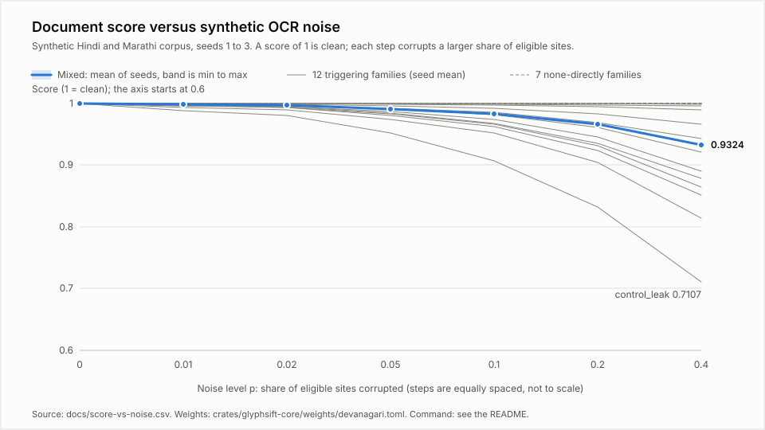

# glyphsift

Scores whether extracted Indic text is clean enough to trust or train on: a deterministic
Devanagari grapheme-cluster validator with a Rust core, a WASM build for the browser, a Python
wheel and a CLI. Sixteen structural rules, a document score from 0 to 1, per-line scores, no model
and no network.

Part of [Airplane Mode Labs](https://github.com/AirplaneMode-Labs), an open-core, offline-first,
browser-native AI infrastructure lab. Package names use the placeholder scope `@airplanemode` /
crate and package names `glyphsift` until the handles are reserved; nothing is published yet.

Status (Sprint 2): the validator, the score, the CLI, the WASM and Python bindings and the
score-versus-noise benchmark work and are tested on this repository's synthetic text only. Not
released: no tag, no package.

## Install

Nothing is published. From a clone:

```sh
cargo build --release            # core + CLI -> target/release/glyphsift
scripts/install-wasm-tools.sh    # wasm-bindgen 0.2.129 and binaryen from digest-pinned release binaries (default ~/.local/glyphsift-tools)
scripts/build-wasm.sh            # dist/wasm/{web,nodejs}; needs wasm-bindgen 0.2.129 and wasm-opt
scripts/build-demo.sh            # demo/dist/: the GitHub Pages demo (runs build-wasm.sh first)
uvx maturin build --release -m crates/glyphsift-py/Cargo.toml -o target/wheels   # cp39-abi3 wheel
```

## Quick start

```sh
echo 'नमस्ते।' | cargo run -q -p glyphsift-cli -- check -
# {"spec":"glyphsift.report/0.2","script":"devanagari","code_points":7,"clusters":[...],"issues":[],
#  "summary":{...},"lines":[{"index":0,...,"score_ppm":1000000}],"score":{"ppm":1000000,"penalty":0,...}}

printf 'कखग\xef\xbf\xbd' | cargo run -q -p glyphsift-cli -- check - --fail-under 800000 > /dev/null; echo $?
# score 750000 is below 800000: the report is printed, the exit code is 4
```

`glyphsift check FILE|-` prints the canonical JSON report. Exit codes: 0 report printed and the
score is not under `--fail-under`; 1 I/O error, invalid UTF-8 or input over 4 MiB; 2 usage error;
4 score below `--fail-under` (a threshold in parts per million, 0 to 1000000).

Python (after `maturin develop`): `glyphsift.validate(text)` returns the same JSON string,
`glyphsift.score_ppm(text)` the integer score, `glyphsift.clusters(text)` the grapheme clusters.

Browser or Node (after `scripts/build-wasm.sh`): `validate(text)`, `score_ppm(text)`,
`report_spec()`, `clusters(text)`, `clusters_json(text)`, `issue_kinds()`; nothing else is exported.
All three runtimes return byte-identical reports.

The corruption generator and the benchmark, both in the CLI:

```sh
glyphsift corrupt --family matra_detach --p 0.05 --seed 7 < bench/corpus/clean.txt > out.txt
glyphsift corrupt --list-families
glyphsift bench --corpus bench/corpus/clean.txt --seeds 1,2,3 --csv docs/score-vs-noise.csv --svg docs/score-vs-noise.svg
```

## How it works

1. Text is split into UAX #29 extended grapheme clusters (unicode-segmentation 1.13, including the
   Unicode 15.1 GB9c conjunct rule, so `क्ष` is one cluster).
2. Each cluster is parsed once, left to right, against the Devanagari cluster grammar
   `(C nukta? virama (ZWJ|ZWNJ)?)* C nukta? matra? (anusvara|chandrabindu)? visarga?` and its
   alternatives for independent vowels and standalone signs, and checked by sixteen rules, each
   a small predicate with a stable name (`dependent_vowel_without_base`, `double_matra`,
   `virama_after_matra`, `zwj_zwnj_misplaced`, `mixed_script_in_cluster`, `control_character`, ...).
   The code-point tables, the grammar and every rule are in
   [docs/devanagari-rules.md](docs/devanagari-rules.md); the executable form is the case table
   `crates/glyphsift-core/tests/cases/devanagari.toml` (93 cases, written before the code).
3. Each flagged cluster costs the **largest** weight among its issues. Weights are integers from 1
   to 1000, one per rule, in [crates/glyphsift-core/weights/devanagari.toml](crates/glyphsift-core/weights/devanagari.toml),
   every line with a `# source:` comment. The document score is an integer in parts per million:

   ```text
   ppm = 1_000_000 - floor(penalty * 1000 / cluster_count)      (saturating; 1_000_000 for empty input)
   ```

   so one broken cluster out of four at weight 1000 scores 750_000. The same formula gives a score per
   line (`lines[i].score_ppm`; LF, CRLF or a bare CR ends a line). Shown with four decimals by integer
   formatting, truncated: 704762 is 0.7047.
4. The report (`glyphsift.report/0.2`) is serialised as compact JSON with fields in declaration order
   and no floating point, so native, Python and WASM builds emit byte-identical output.

Determinism is enforced: `clippy.toml` forbids hash-based collections and the platform `libm`, a test
scans `glyphsift-core/src` for floating-point types and hash collections, and the core reads no
clock, environment or file.

## Contracts

glyphsift consumes no runtime/spec contract yet. From Sprint 3 its WASM build will emit
`airplanemode.event/0.1` events through the runtime `EventSink` for timings only; the text being
scored never leaves the process. Its own wire format is the report, `glyphsift.report/0.2`
(docs/devanagari-rules.md section 5).

## Demo

Live demo: <https://airplanemode-labs.github.io/glyphsift/>. Built from `main` by
`.github/workflows/pages.yml` on every push, with a box titled "What this demo does not do yet". It
runs entirely in the browser: no upload, no analytics, no third-party scripts or fonts.

It shows the real report for pasted text or one of five synthetic samples (clean, OCR-corrupted,
legacy font read as Latin, legacy font residue, adversarial): the document score with four decimals, a
per-line table with each line's score and issues, the sixteen rules with their weights and how often
each fired, the grapheme clusters, and the canonical JSON, which is byte for byte what
`glyphsift check -` prints for the same text. Pasted input over 1 MiB of UTF-8 is refused before the
WASM module is called; every report-derived string is rendered with `textContent`. Sources in
`demo/`; `scripts/build-demo.sh` assembles `demo/dist/` (git-ignored). Verification: see Develop.

## Benchmarks



Reproduce (about one second in release mode; the CSV and SVG come out byte-identical every time):

```sh
cargo run -p glyphsift-cli --release -- bench --corpus bench/corpus/clean.txt --seeds 1,2,3 --csv docs/score-vs-noise.csv --svg docs/score-vs-noise.svg
```

The benchmark corrupts the 288-line synthetic Hindi and Marathi corpus `bench/corpus/clean.txt`
(6,117 clusters, every line validating with zero issues) at p in {0, 0.01, 0.02, 0.05, 0.1, 0.2, 0.4}
with each of the 19 noise families of [docs/corruption-generator.md](docs/corruption-generator.md)
and with `mixed` (every family on a disjoint partition of the sites), seeds 1 to 3, and scores each
result. The command exits 1 on any violation of this criterion:

- (a) the mixed-family mean score (over seeds) falls STRICTLY at every consecutive step from p=0 to p=0.4;
- (b) mixed is non-increasing in p for each seed;
- (c) every triggering family is non-increasing in p for each seed;
- (d) score_ppm is 1_000_000 at p=0 for every row.

"Triggering" means the family's "rules it should trigger" column in the corruption doc names rules
(twelve families); the other seven are "none directly" and are reported, not gated. All four parts
hold on the committed `docs/score-vs-noise.csv` (420 rows), and `glyphsift bench --verify
docs/score-vs-noise.csv` re-checks them without regenerating. Evidence: `evidence/sprint-2/D3/bench-run-1.log`
(first run), `evidence/sprint-2/D3/bench-determinism.log` (two further runs, SHA-256 of the CSV and SVG logged twice,
equal to each other and to the committed files), `evidence/sprint-2/D3/pre-bench-hashes.log` (SHA-256 of the
weights file and the corpus, taken before the first run). Numbers below are from `docs/score-vs-noise.csv`
and are scores, 1.0000 being clean; figures are rounded half-up to four decimals from `docs/score-vs-noise.csv`
(score_ppm divided by 1,000,000).

| Mixed family | p=0 | p=0.01 | p=0.02 | p=0.05 | p=0.1 | p=0.2 | p=0.4 |
|---|---|---|---|---|---|---|---|
| mean of seeds 1 to 3 | 1.0000 | 0.9985 | 0.9969 | 0.9916 | 0.9837 | 0.9671 | 0.9324 |
| minimum | 1.0000 | 0.9983 | 0.9968 | 0.9910 | 0.9826 | 0.9646 | 0.9310 |
| maximum | 1.0000 | 0.9987 | 0.9970 | 0.9925 | 0.9849 | 0.9699 | 0.9347 |

The twelve triggering families, mean of seeds 1 to 3:

| Family | p=0.05 | p=0.4 |
|---|---|---|
| `matra_double` | 0.9865 | 0.8906 |
| `matra_detach` | 0.9846 | 0.8788 |
| `nukta_spurious` | 0.9959 | 0.9669 |
| `virama_insert` | 0.9748 | 0.8143 |
| `bindu_swap` | 0.9999 | 0.9991 |
| `sign_order` | 0.9995 | 0.9956 |
| `joiner_inject` | 0.9912 | 0.9216 |
| `legacy_font` | 0.9989 | 0.9894 |
| `word_boundary` | 0.9838 | 0.8643 |
| `random_substitution` | 0.9927 | 0.9427 |
| `mixed_script` | 0.9806 | 0.8510 |
| `control_leak` | 0.9516 | 0.7108 |

Recall at p=0.05, the share of corrupted sites that declare an expected rule for which that rule fired in
the damaged cluster, is 1.000000 for every family that declares a rule, in every seed that has one
(`bindu_swap` declares a rule only on its 20% keep-both branch, so seed 3 has none at p=0.05; the
`recall_ppm` column of the CSV is empty where no site declares a rule).

| Throughput on about 1 MiB of the synthetic corpus (12,888 lines, 273,779 clusters) | Apple-silicon development Mac (placeholder) | 8 GB Windows no-GPU laptop |
|---|---|---|
| native `glyphsift check`, wall clock | 0.05 to 0.06 s (one cold run 0.17 s) | not measured |
| WASM `validate()` in Node, best of 5 | 232 ms | not measured |
| WASM `score_ppm()` in Node, best of 5 | 75 ms | not measured |

Command and evidence: `evidence/sprint-2/D3/throughput.log` (the native line is `target/release/glyphsift
check` on the 1 MiB file, five runs; the WASM lines are `validate()` and `score_ppm()` from
`dist/wasm/nodejs` on the same text, best of five). Browser figures: not measured. Lines per second in
the browser: not measured.

## Limitations

- **Structural checks only.** The validator judges the order and combination of code points inside
  one cluster. It has no dictionary and no language model: a well-formed nonsense word scores clean, and
  so does a visually plausible OCR confusion (`ब` for `व`).
- **The "none directly" families are invisible to it, by design.** Seven noise families change the
  text without breaking any structural rule, and the score does not move for them. Their curves
  (`docs/score-vs-noise.csv`, mean of seeds 1 to 3, every step 1.0000):

  | Family | p=0 | p=0.01 | p=0.02 | p=0.05 | p=0.1 | p=0.2 | p=0.4 |
  |---|---|---|---|---|---|---|---|
  | `matra_drop` | 1.0000 | 1.0000 | 1.0000 | 1.0000 | 1.0000 | 1.0000 | 1.0000 |
  | `matra_swap` | 1.0000 | 1.0000 | 1.0000 | 1.0000 | 1.0000 | 1.0000 | 1.0000 |
  | `nukta_loss` | 1.0000 | 1.0000 | 1.0000 | 1.0000 | 1.0000 | 1.0000 | 1.0000 |
  | `virama_delete` | 1.0000 | 1.0000 | 1.0000 | 1.0000 | 1.0000 | 1.0000 | 1.0000 |
  | `reph_misplace` | 1.0000 | 1.0000 | 1.0000 | 1.0000 | 1.0000 | 1.0000 | 1.0000 |
  | `ocr_confusion` | 1.0000 | 1.0000 | 1.0000 | 1.0000 | 1.0000 | 1.0000 | 1.0000 |
  | `digit_danda` | 1.0000 | 1.0000 | 1.0000 | 1.0000 | 1.0000 | 1.0000 | 1.0000 |

  Legacy-font text read back as Latin letters is the same kind of blind spot: it scores 1.0000.
- **The benchmark proves a narrow thing.** The score falls as injected structural damage rises, on 288
  invented lines. The noise is synthetic, each family's expected rules were chosen by the author, the
  weights were set by the author before the first run and were never tuned on the benchmark, and the
  monotone fall is partly by construction (the corrupted sites at one p are a subset of those at the
  next, and a flagged cluster only adds penalty). It is not a measurement of real OCR or of how well the
  score predicts the quality of a real document. No real document has been scored.
- **Devanagari only.** Text in other scripts is plain text and is never flagged; Tamil and Bengali come later.
- **Joiners in non-Devanagari clusters are flagged.** `zwj_zwnj_misplaced` (weight 200, the lowest) has no
  script condition, so a ZWJ or ZWNJ not preceded by a virama is reported wherever it occurs. Two cases:
  an emoji family sequence (several emoji joined by ZWJ) lowers the score of an otherwise clean Hindi
  line, and a Persian word written with a ZWNJ inside it is flagged too. The effect on the score is small
  but real. Restricting the rule to Devanagari bases, with table cases first, is on the v0.1 list in the
  CHANGELOG. Bench outputs and weights are unchanged.
- **Invisible Extend characters on a Devanagari base are not flagged.** Unicode tag characters
  (`U+E0001`, `U+E0020` to `U+E007F`) and non-Indic combining marks such as `U+0301` join the preceding
  cluster (they are Grapheme_Cluster_Break=Extend) and no rule fires, so a line containing them can
  score clean; tag characters are invisible, so hidden text survives a clean verdict. A combining mark
  from another Indic block (for example Bengali `U+09BE`) is flagged. Documented in
  docs/devanagari-rules.md section 2; flagging both, table cases first, is on the v0.1 list in the
  CHANGELOG. Bench outputs and weights are unchanged.
- **Clusters are judged in isolation.** Word- and document-level signals (legacy-font detection, a run of
  meaningless words, repeated clusters) are not implemented.
- **No normalisation.** Input is judged as given, so `U+0958` plus a nukta is a double nukta even
  though NFC would give the same bytes as `क़`. Devanagari Extended cantillation marks are flagged as
  unexpected (docs/devanagari-rules.md section 7).
- **Input limit.** `validate` refuses input over 4 MiB (the report holds one record per cluster); the
  demo accepts at most 1 MiB. Over a 1 MiB input the report is large (the WASM safety script runs one).
- **No heatmap, no drag-and-drop, no service worker** in the demo; see its "What this demo does not do
  yet" box. Nothing is published: no crate, wheel or npm package, no tag.
- **Windows.** The determinism job and the installer's Windows branch are configured, not yet executed:
  nothing has run on a Windows runner until the repository is pushed. The 8 GB Windows no-GPU column above
  reads "not measured".
- **Native-speaker review wanted.** The case table encodes the author's reading of the Unicode Standard
  chapter 12 and common OCR and legacy-font failure modes; the corpus is invented by the author.
- **What comes next.** Sprint 3 (plan): v0.1 with a per-line heatmap, the Python wheel and an npm package (once the
  owner has reserved the handles), `airplanemode.event/0.1` timings; later Tamil or Bengali and language-independent scoring.

## Security and privacy

- No network egress: the core, the CLI, the wheel and the WASM build make no network requests and
  send no telemetry. The demo makes requests only for its own files, under a CSP with no inline script
  or style and `connect-src 'self'`.
- What is stored where: nothing. The CLI reads the file (or stdin) it is given and writes to
  stdout; the library holds the input only for the duration of the call.
- Inputs are treated as untrusted text: the validator never interprets them, allocates in
  proportion to their length, caps input at 4 MiB, and has no recursion over input. A 20,000-string
  fuzz test (native) and the same set in WASM (`tests/wasm/run_wasm_safety.mjs`) finish with no panic and
  no trap, and a 5,000-mark run takes about twice as long as a 2,500-mark run (linear).
- The benchmark's SVG is inert: no script, event handler, link or external reference, all text escaped
  (tests assert it). The demo renders every report-derived and pasted string with `textContent` only;
  `scripts/check-demo-sources.sh` fails the build on `innerHTML`, `outerHTML` or `insertAdjacentHTML`.
- Supply chain: CI downloads cargo-deny, wasm-bindgen and binaryen as release binaries and checks each
  against a SHA-256 pinned in the repository before use; every action is pinned by commit SHA.
- Report vulnerabilities as described in [SECURITY.md](SECURITY.md).

## Develop

```sh
cargo fmt --all --check
cargo clippy --workspace --all-targets -- -D warnings
cargo test                                     # core + cli: 93-case table, fuzz, score, corruption, check, bench
cargo test -p glyphsift-wasm                   # the WASM bindings' native unit tests
cargo check -p glyphsift-core --target wasm32-unknown-unknown
cargo check -p glyphsift-wasm --target wasm32-unknown-unknown
cargo check -p glyphsift-py                    # needs a python3 on PATH for the PyO3 build script
cargo deny --all-features check                # needs cargo-deny 0.20.2; CI runs the pinned binary
scripts/determinism.sh                         # native, Python and WASM against tests/determinism/expected, plus the WASM safety script
scripts/build-demo.sh                          # the Pages demo; CI's `demo` job runs the same command
cargo run -q -p glyphsift-cli --release -- bench --verify docs/score-vs-noise.csv
```

Browser check of the built demo, under `/glyphsift/` from a server that answers 404 for every other path,
in installed Chrome (Playwright is not a dependency of this repository; install it anywhere):

```sh
(cd /some/scratch/dir && npm i playwright@1.65.0)
PLAYWRIGHT_DIR=/some/scratch/dir node tests/demo/check_demo.mjs --cli target/release/glyphsift
```

Tests come before implementation: add a case to `tests/cases/devanagari.toml` first (the file is
the rules' specification), then make it pass; a weight or corpus change after the first benchmark run
is a `CHANGELOG.md` entry with its reason. The determinism samples contain invisible characters, CRLF and a
BOM on purpose; `.gitattributes` keeps git from normalising them. See [CONTRIBUTING.md](CONTRIBUTING.md).

## Licence

Apache-2.0. See [LICENSE](LICENSE) and [NOTICE](NOTICE). The licence was chosen on day one and
will not change.
